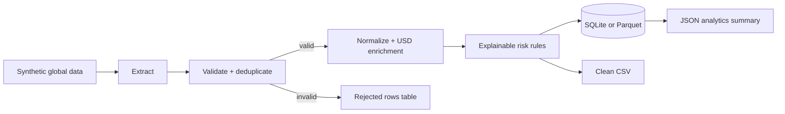

# Worldwide Transactions Data Pipeline

A portfolio-ready transaction ETL project with two execution paths: a dependency-free Python/SQLite demo and a distributed PySpark pipeline whose default workload is one million synthetic records. Both paths generate transactions across ten countries, validate and normalize them, convert values to USD using fixed demo rates, hash account identifiers, assign explainable risk signals, quarantine bad rows, and produce analytics-ready outputs.

All records are synthetic. No live banking data, credentials, paid APIs, or network access are used.

## Architecture



## What the pipeline demonstrates

- Deterministic dummy-data generation for IN, US, GB, DE, BR, SG, NG, AE, JP, and AU.
- Schema validation, ISO country/currency normalization, timezone checks, and duplicate handling.
- Fixed-rate multi-currency conversion for a reproducible offline demo.
- SHA-256 account pseudonymization before clean data is persisted.
- Explainable risk bands based on high value, cross-border activity, wire channel, and failed status.
- Data-quality quarantine with the original row and rejection reason.
- Atomic SQLite loading, indexed analytics tables, run metadata, clean CSV, and JSON summary.
- Lightweight standard-library pipeline for local demos.
- Distributed PySpark 4.2 pipeline with a one-million-record default, executor-side generation, partitioned Parquet, and CI integration testing.

## Lightweight quick start

From this folder, with Python 3.10+:

```powershell
python run_pipeline.py demo --count 1000 --seed 42
python -m unittest discover -s tests -v
```

Generated files:

```text
data/raw/world_transactions.csv     synthetic source data
output/clean_transactions.csv       validated and enriched rows
output/world_transactions.db        SQLite warehouse (ignored by Git)
output/summary.json                  country/category analytics
```

You can also run stages separately:

```powershell
python run_pipeline.py generate --output data/raw/world_transactions.csv --count 5000
python run_pipeline.py run --input data/raw/world_transactions.csv --output-dir output
```

## Million-row PySpark pipeline

Requirements:

- Python 3.10+
- Java 17+ with `JAVA_HOME` configured
- PySpark 4.2.0

Install the optional Spark dependency:

```powershell
python -m pip install -r requirements-spark.txt
```

Process one million records using all local CPU cores:

```powershell
python run_spark_pipeline.py --count 1000000 --master "local[*]" --partitions 8
```

The scalable path uses `spark.range()` and Spark SQL expressions, so it does not build a million-row Python list on the driver. It writes:

```text
output/spark-million/raw_transactions/       country-partitioned Parquet
output/spark-million/clean_transactions/     country-partitioned Parquet
output/spark-million/rejected_transactions/  quarantined Parquet
output/spark-million/analytics_by_country/   JSON analytics
output/spark-million/analytics_by_category/  JSON analytics
output/spark-million/spark_summary.json       run totals
```

Use `--count 10000` for a quick local smoke test before the million-row run.

## Tables

| Table | Purpose |
| --- | --- |
| `clean_transactions` | Normalized, pseudonymized, risk-enriched facts |
| `rejected_transactions` | Bad/duplicate rows with deterministic reasons |
| `pipeline_runs` | Source path, timestamps, and row counts for every run |

## Risk rules

| Signal | Points |
| --- | ---: |
| USD value at least 10,000 | 45 |
| Cross-border transaction | 25 |
| Wire channel | 15 |
| Failed status | 20 |

Bands are `LOW` (0-29), `MEDIUM` (30-59), and `HIGH` (60-100). These are transparent demo rules, not a fraud model and not suitable for real financial decisions.

## Production extension path

For production, point the PySpark pipeline at Kafka or object storage instead of synthetic input, use a versioned FX-rate table, and load Parquet/Delta data into a warehouse. Add a schema registry, secret-managed hashing key, orchestration with Airflow/Dagster, observability, checkpointing, retention policies, and human-reviewed risk logic before using real data.
